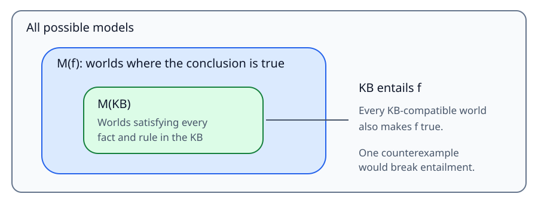

# Chapter 7 — Logical Agents

**Course:** CAI 4002 — Introduction to Artificial Intelligence (USF Fall 2026)

**Sections:** 7.1 Knowledge-Based Agents (pp. 227–228) · 7.3 Logic (pp. 232–235) · 7.4.1 Syntax (pp. 235–236) · 7.4.2 Semantics (pp. 236–238) · 7.4.4 A Simple Inference Procedure (pp. 238–240) · 7.5 Propositional Theorem Proving and 7.5.1 Inference and Proofs (pp. 240–243) · 7.5.2 Proof by Resolution (pp. 243–247) · 7.5.3 Horn Clauses and Definite Clauses (pp. 247–248) · 7.5.4 Forward and Backward Chaining, forward-chaining portion (pp. 248–249).

**Class notes:** *Day 5 — Expectimax / Logical Reasoning*, slides 25–73; *Day 7 — PL Semantics & Inference*, slides 3–30; *Day 8 — Soundness and Completeness*, slides 2–47; *Day 9 — Probability Theory / MDP*, slides 2–4. Probability material is in [Chapter 12](chapter-12-quantifying-uncertainty.md); MDPs are in [Chapter 16](chapter-16-making-complex-decisions.md). Day 5 adversarial-search material is in [Chapter 6](chapter-06-adversarial-search-and-games.md#day-5--expectimax-lecture).

## Section 7.1 — Knowledge-Based Agents

### 1. Knowledge and Inference

> **Definition (Knowledge base).** A knowledge base, or KB, is a set of sentences representing assertions about the world in a knowledge representation language.

> **Definition (Axiom).** A sentence accepted as given rather than derived from other sentences.

> **Definition (Inference).** Deriving new sentences from existing sentences. A justified answer must follow from the knowledge already supplied, not be invented.

| Operation | Purpose |
|---|---|
| **TELL** | add a sentence to the KB |
| **ASK** | query what follows from the KB, including which action to choose |

Both operations may involve inference. The KB can begin with background knowledge and grow as the agent receives percepts.

### 2. The Agent's Reasoning Cycle

1. **Record the percept:** TELL the KB what was observed at the current time.
2. **Choose an action:** ASK what action should be performed, using observations, background knowledge, and goals.
3. **Record the action:** TELL the KB which action was selected for execution.
4. **Execute and advance time:** return the action and update the time counter.

Time labels distinguish observations and actions at different moments. The interfaces translate percepts into sentences, goals into action queries, and selected actions into action sentences; TELL and ASK hide the inference machinery.

| Distinction | Meaning |
|---|---|
| **Knowledge level** | what the agent knows and wants to accomplish |
| **Implementation level** | how sentences are stored and reasoning is performed |
| **Declarative approach** | supply facts and rules, then let a reasoner determine behavior |
| **Procedural approach** | encode the desired behavior directly as program steps |

An agent can combine declarative and procedural elements. Learning can add general knowledge from experience rather than requiring the designer to supply every rule.

## Section 7.4.1 — Syntax

### 3. Propositions and Well-Formed Formulas

> **Definition (Proposition).** A declarative statement that can be true or false. Questions, greetings, and commands are not propositions.

> **Definition (Syntax).** The rules specifying which expressions are allowable sentences, or **well-formed formulas**, without determining their truth.

An **atomic sentence** is a single proposition symbol such as $P$, $Q$, $\text{FacingEast}$, or $W_{1,3}$. A subscripted name is still one indivisible symbol: propositional logic does not interpret its pieces. **True** and **False** have fixed meanings.

A **complex sentence** combines simpler sentences using parentheses and connectives. These rules are recursive: a connective's inputs can themselves be complex sentences.

| Connective | Name | Parts / terminology |
|---|---|---|
| $\neg P$ | negation, “not” | negated sentence |
| $P \land Q$ | conjunction, “and” | $P$ and $Q$ are conjuncts |
| $P \lor Q$ | disjunction, “or” | $P$ and $Q$ are disjuncts |
| $P \Rightarrow Q$ | implication, “if … then” | $P$ is the antecedent/premise; $Q$ is the consequent/conclusion |
| $P \Leftrightarrow Q$ | biconditional, “if and only if” | asserts both implication directions |

> **Definition (Literal).** An atomic sentence, called a positive literal, or its negation, called a negative literal.

$P$ and $\neg P$ are literals; $\neg(P \land Q)$ is not a literal because it negates a complex sentence.

### 4. Precedence and Valid Structure

From highest to lowest binding strength:

$$
\neg,\quad \land,\quad \lor,\quad \Rightarrow,\quad \Leftrightarrow
$$

Thus $\neg A \land B$ means $(\neg A) \land B$, not $\neg(A \land B)$. Use parentheses to make the intended grouping explicit.

| Expression | Well formed? | Reason |
|---|---|---|
| $\neg A$ | yes | negation of a sentence |
| $(\neg B \Rightarrow C) \lor A$ | yes | valid recursive combination |
| $A \lor \Rightarrow \lor A$ | no | binary connectives lack sentence operands |
| $A + B$ | no | addition is not a propositional connective |
| $A\neg B$ | no | no connective joins the two sentences |

Symbol names alone do not supply meaning. A formula can be syntactically valid without being true or useful.

## Section 7.4.2 — Semantics

### 5. Models and Truth Values

> **Definition (Semantics).** Rules determining whether a sentence is true or false in a particular model.

> **Definition (Propositional model).** An assignment of true or false to every relevant proposition symbol.

With $n$ independently assignable proposition symbols, there are $2^n$ possible models. Fixed constants True and False do not add independent choices.

To evaluate a complex formula, look up atomic truth values in the model, then evaluate its connectives from the inside outward. A model is a mathematical assignment; interpreting a symbol as a real-world claim is a separate step.

### 6. Truth Tables

| $P$ | $Q$ | $\neg P$ | $P \land Q$ | $P \lor Q$ | $P \Rightarrow Q$ | $P \Leftrightarrow Q$ |
|---|---|---|---|---|---|---|
| F | F | T | F | F | T | T |
| F | T | T | F | T | T | F |
| T | F | F | F | T | F | F |
| T | T | F | T | T | T | T |

- **NOT:** reverses the truth value.
- **AND:** true only when both inputs are true.
- **OR:** inclusive; true when at least one input is true, including when both are true. Exclusive OR would reject the both-true case.
- **Implication:** false only when the antecedent is true and the consequent is false.
- **Biconditional:** true when the two inputs have the same truth value.

### 7. Why Implication Can Be True with a False Antecedent

“If $P$, then $Q$” rules out just one case: $P$ occurs but $Q$ does not. If $P$ is false, the conditional has not been violated, regardless of $Q$. This is **vacuous truth**.

The lecture's lottery promise illustrates the idea: not winning the lottery does not break a promise to pay *if* you win.

$$
P \Rightarrow Q \equiv \neg P \lor Q
$$

Implication does **not** assert causation, relevance, or the reverse implication. A biconditional makes the stronger claim that both directions hold:

$$
P \Leftrightarrow Q \equiv (P \Rightarrow Q) \land (Q \Rightarrow P)
$$

The Wumpus rule “a square is breezy if and only if an adjacent square has a pit” uses this two-way relationship:

$$
B_{1,1} \Leftrightarrow (P_{1,2} \lor P_{2,1})
$$

## Day 5 — Logical Reasoning (Lecture)

### 8. From State-Based Search to Logic-Based Reasoning

| Model | Representation | Main question |
|---|---|---|
| **State-based** | states, actions, costs or utilities | which path or move is best? |
| **Logic-based** | facts, formulas, inference rules | what follows from what is known? |

Logic lets an agent combine information and reason about changed assumptions or rules. Its goals include representing knowledge, reasoning with it, and communicating it precisely.

Natural language can be ambiguous. In the lecture's “nothing is better than world peace” example, **nothing** means “no thing,” not an object that can be inserted into an ordinary ranking. Formal languages make the intended structure explicit rather than treating ambiguous English as a valid proof.

### 9. Equivalent Formulas and a Smaller Connective Set

> **Definition (Logical equivalence).** Two formulas are equivalent when they have the same truth value in every model, or equivalently, the same set of satisfying models.

$\equiv$ states an equivalence **between formulas**; $\Leftrightarrow$ is a connective **inside a formula**. Equivalent formulas can replace one another without changing meaning.

All five connectives can be expressed using only **NOT and OR**. Eliminate the biconditional and implication using the identities above, then eliminate AND:

$$
P \land Q \equiv \neg(\neg P \lor \neg Q)
$$

The lecture's standard equivalences are:

$$
\begin{aligned}
P \land Q &\equiv Q \land P &&\text{commutativity} \\
P \lor Q &\equiv Q \lor P \\
(P \land Q) \land R &\equiv P \land (Q \land R) &&\text{associativity} \\
(P \lor Q) \lor R &\equiv P \lor (Q \lor R) \\
\neg\neg P &\equiv P &&\text{double negation} \\
P \Rightarrow Q &\equiv \neg Q \Rightarrow \neg P &&\text{contraposition} \\
P \Rightarrow Q &\equiv \neg P \lor Q &&\text{implication elimination} \\
P \Leftrightarrow Q &\equiv (P \Rightarrow Q) \land (Q \Rightarrow P) &&\text{biconditional elimination} \\
\neg(P \land Q) &\equiv \neg P \lor \neg Q &&\text{De Morgan's laws} \\
\neg(P \lor Q) &\equiv \neg P \land \neg Q \\
P \land (Q \lor R) &\equiv (P \land Q) \lor (P \land R) &&\text{distributivity} \\
P \lor (Q \land R) &\equiv (P \lor Q) \land (P \lor R)
\end{aligned}
$$

### 10. Formulas as Sets of Models

> **Definition (Satisfaction).** A model satisfies a formula when the formula evaluates to true in that model.

Write $M(f)$ for the set of models satisfying formula $f$. A KB requires **every** sentence in it to be true, so its satisfying models are an intersection:

$$
M(\mathrm{KB}) = \bigcap_{f \in \mathrm{KB}} M(f)
$$

Each added fact or rule constrains which worlds remain possible. For $P \lor Q$, all assignments except the both-false assignment satisfy the formula. For $\mathrm{KB}=\lbrace P,Q \rbrace$, only the both-true assignment satisfies the KB.

> **Definition (Entailment).** A KB entails a formula when that formula is true in every model satisfying the KB.

$$
\mathrm{KB} \models f
\quad\text{if and only if}\quad
M(\mathrm{KB}) \subseteq M(f)
$$

**The subset direction matters:** all KB-compatible worlds must be inside the conclusion's model set. A formula being true in *one* compatible world is not enough. To disprove entailment, find one model where the KB is true and the proposed conclusion is false.

Failure to establish $f$ does not automatically establish $\neg f$; the available knowledge may leave both possibilities open.

### 11. Inference Rules and Forward Inference

> **Definition (Inference rule).** A pattern allowing a conclusion to be derived from matching premises. Rules operate on syntax; their justification comes from semantics.

| Rule | Required premises | Conclusion |
|---|---|---|
| **Modus ponens** | $P$, $P \Rightarrow Q$ | $Q$ |
| **Modus tollens** | $\neg Q$, $P \Rightarrow Q$ | $\neg P$ |
| **Hypothetical syllogism** | $P \Rightarrow Q$, $Q \Rightarrow R$ | $P \Rightarrow R$ |
| **Disjunctive syllogism** | $P \lor Q$, $\neg P$ | $Q$ |
| **Disjunctive addition** | $P$ | $P \lor Q$ |

A rule is truth-preserving if every model satisfying all premises also satisfies the conclusion. Truth tables can check this without assuming the propositions concern a particular topic.

**Forward inference:** repeatedly match rules against known formulas and add their conclusions. Continue until the target is derived or no new formulas are produced. Treat the KB as a set so rediscovering a formula does not count as progress. Exhaustive application can be costly; unrestricted rules can generate infinitely many distinct formulas, so reaching a fixed point is not guaranteed in general.

For the lecture's rain rules, knowing Rain and Rain implies Wet allows Wet to be added; knowing Wet implies Slippery then allows Slippery to be added. This is a chain of rule applications, not enumeration of every possible world.

Example — What follows from the knowledge base?

*Original practice modeled on the Day 8 inference-rule slides.*

Assume every statement below is true:

1. $A \lor B$
2. $\neg A$
3. $B \Rightarrow C$
4. $D \Rightarrow C$

Which conclusion must be true in every model satisfying this knowledge base?

| Choice | Conclusion |
|---|---|
| **A** | $C$ |
| **B** | $D$ |
| **C** | $\neg D$ |
| **D** | $A \land C$ |

Solution

**Correct answer: choice A, the statement $C$.**

| Step | Reasoning | Inference rule |
|---|---|---|
| 1 | $A \lor B$ requires at least one to be true. Since $\neg A$ makes $A$ false, $B$ must be true. | Disjunctive syllogism |
| 2 | $B$ is true and $B \Rightarrow C$ is given, so $C$ must be true. | Modus ponens |

**Why neither $D$ nor $\neg D$ follows:** the rule $D \Rightarrow C$ says that $D$ is sufficient for $C$, not that $D$ is necessary. A true $C$ does not tell us whether $D$ is true. Both assignments below satisfy every premise:

| $A$ | $B$ | $C$ | $D$ |
|---|---|---|---|
| F | T | T | F |
| F | T | T | T |

The conclusion $A \land C$ cannot hold because $A$ is false. Distinguish the **proposition symbol $C$** from the **answer label C**, which names $\neg D$ in this question.

### 12. Derivation, Soundness, and Completeness

> **Definition (Derivation).** A formula is derivable when the chosen inference procedure can produce it from the KB. Write $\mathrm{KB} \vdash_i f$ for derivation by procedure $i$.

| Notation | Meaning | Perspective |
|---|---|---|
| $\mathrm{KB} \models f$ | $f$ is true in every KB-compatible model | semantic relationship |
| $\mathrm{KB} \vdash_i f$ | procedure $i$ can prove $f$ from the KB | syntactic computation |

> **Definition (Soundness).** Everything the procedure derives is entailed: it produces no unjustified conclusions.

$$
\mathrm{KB} \vdash_i f \quad\Longrightarrow\quad \mathrm{KB} \models f
$$

> **Definition (Completeness).** Every entailed formula can be derived by the procedure: it misses no logical consequences.

$$
\mathrm{KB} \models f \quad\Longrightarrow\quad \mathrm{KB} \vdash_i f
$$

**Sound = nothing but the truth. Complete = the whole truth.** Together, derivability and entailment coincide. These guarantees concern what follows from the premises; sound reasoning cannot ensure real-world truth if the KB's premises are wrong.

Modus ponens is sound, but **modus ponens alone is not complete for unrestricted propositional logic**. In the lecture's KB containing Rain and “Rain OR Snow implies Wet,” Wet is entailed, but modus ponens cannot fire without the exact premise Rain OR Snow. Disjunctive addition would supply that missing premise. Completeness depends on the available rules and the language being considered.

“Backward modus ponens,” inferring $P$ from $Q$ and $P \Rightarrow Q$, is **unsound**. This is the fallacy of **affirming the consequent**: $P$ can be false while $Q$ and the implication are true. Wet ground, for instance, does not prove that it rained.

## Day 7 — PL Semantics and Inference (Lecture)

### 13. Evaluating a Formula Is Not Proving It

Keep these three tasks separate:

| Task | What is supplied? | What must be checked? |
|---|---|---|
| **Evaluation** | a formula and one model | whether the formula is true in that assignment |
| **Model checking for entailment** | a KB and a query | whether every assignment satisfying the KB also satisfies the query |
| **Rule-based proof** | a KB and allowed inference rules | whether a sequence of rule applications derives the query |

A single satisfying assignment establishes possibility, not entailment. For truth-table entailment checking, enumerate assignments to every symbol in the KB **and the query**. Ignore rows where the KB is false; a row with a true KB and false query is a countermodel. If no countermodel exists, the query is entailed.

Truth-table checking is sound and complete for propositional logic, but examines up to $2^n$ assignments for $n$ symbols. Rule-based reasoning can avoid most of those assignments when a short proof exists. A particular rule set may still miss consequences even when each of its rules is sound.

## Day 8 — Soundness, Completeness, and Resolution (Lecture)

### 14. Restrict the Language or Strengthen the Rules

There are two ways to repair an incomplete inference method:

| Approach | Main idea | Trade-off |
|---|---|---|
| **Restrict the KB** | use definite/Horn clauses with suitable forward chaining | efficient, but less expressive rule structure |
| **Strengthen inference** | convert general formulas to CNF and use resolution refutation | handles unrestricted propositional formulas, but can require exponentially many clauses |

Completeness always needs a scope: **which KB language, which queries, and which inference procedure?** It does not mean that every imaginable statement can be generated by repeatedly applying one rule.

### 15. Clauses, Definite Clauses, and Horn Clauses

> **Definition (Clause).** A disjunction of literals. A single literal is a unit clause.

> **Definition (Horn clause).** A clause with at most one positive, unnegated literal. A definite clause has exactly one positive literal; a goal clause has none.

| Form | Clause notation | Implication interpretation |
|---|---|---|
| **Fact** | $Q$ | a positive atom already known |
| **Definite clause** | $\neg P_1 \lor \cdots \lor \neg P_k \lor Q$ | all body atoms together imply the one head atom |
| **Goal clause** | $\neg P_1 \lor \cdots \lor \neg P_k$ | all body atoms together imply False |
| **Not Horn** | $\neg P \lor Q \lor R$ | two positive literals remain |

The definite-clause equivalence is:

$$
(P_1 \land \cdots \land P_k) \Rightarrow Q
\equiv \neg P_1 \lor \cdots \lor \neg P_k \lor Q
$$

In implication form, the conjunction is the **body** and the conclusion is the **head**. A goal clause is a constraint forbidding its body from being entirely true; it is not a positive fact to be produced.

### 16. Generalized Modus Ponens and Forward Chaining

When all body atoms have been established, infer the head:

$$
\frac{P_1,\ldots,P_k,\quad (P_1 \land \cdots \land P_k) \Rightarrow Q}{Q}
$$

With the lecture's Rain and Weekday facts, Rain implies Wet, and Wet together with Weekday implies Traffic. A rule requiring Traffic **and Careless** cannot fire merely because Traffic is known. Missing Careless is not evidence for its negation.

Forward chaining is **data-driven**: begin with known facts and propagate their consequences. An efficient implementation tracks which premises remain unproved, processes each newly inferred atom once, and fires a rule when all its premises are known. This avoids repeatedly scanning every subset of the KB or looping on cyclic rules.

**Precise completeness claim:** forward chaining is sound and complete for **positive atomic queries over a definite-clause KB**. With goal clauses, deriving False detects a violated constraint and supports Horn satisfiability checking. Ordinary positive-fact propagation does not thereby become a procedure that prints every arbitrary entailed formula or negative literal. The slide's “MP is complete for Horn clauses” needs this scope.

Horn rules contain negative literals in their **disjunctive spelling**, but definite-clause forward chaining uses positive atoms in the **body and head**. A rule triggered by a negated condition or concluding a genuine choice between two positive atoms is not a definite rule in this form. This is a restriction of the representation/procedure, not a ban on all negation in logic.

### 17. Resolution

> **Definition (Resolution).** From two clauses containing complementary literals, remove one complementary pair and disjoin the remaining literals to obtain a resolvent.

For clause remainders $C$ and $D$ and an atom $P$:

$$
\frac{C \lor P,\quad D \lor \neg P}{C \lor D}
$$

If $P$ is true, the second premise requires $D$; if $P$ is false, the first requires $C$. Either way the resolvent is true, so the rule is sound. Modus ponens is the special case resolving the unit clause $P$ with $\neg P \lor Q$.

- Resolve **only one complementary pair per step**. Cancelling several pairs at once can produce an unjustified conclusion.
- Remove duplicate literals from a resolvent. A clause containing an atom and its own negation is a tautology and can be discarded.
- Resolving contradictory unit clauses produces the **empty clause**, written $\square$. An OR with no alternatives is False; this is not an empty KB, whose requirements are vacuously satisfied.

### 18. Conjunctive Normal Form

> **Definition (CNF).** A conjunction of clauses: an AND of groups, each containing only an OR of literals.

For example, this is CNF:

$$
(A \lor B \lor \neg C) \land (\neg B \lor D)
$$

Every propositional formula has an equivalent CNF representation. Convert in this order:

1. Eliminate biconditionals, replacing each with two implications joined by AND.
2. Eliminate implications using the NOT/OR equivalence in Section 7.
3. Push negations inward with De Morgan's laws.
4. Remove double negations so NOT applies only to atoms.
5. Distribute **OR over AND**, then flatten repeated ANDs/ORs and remove duplicates.

The crucial distribution direction is:

$$
A \lor (B \land C) \equiv (A \lor B) \land (A \lor C)
$$

Store each outer conjunct as a separate KB clause: all conjuncts must hold. Direct equivalence-preserving distribution can enlarge a formula exponentially; CNF conversion is not guaranteed to be a small rewrite.

Example — Convert an implication to CNF

*Original practice modeled on the Day 8 CNF-conversion slides.*

Convert $(P \lor Q) \Rightarrow (R \land S)$ into an equivalent CNF using only NOT, OR, and AND.

Solution

1. **Eliminate the implication** with $A \Rightarrow B \equiv \neg A \lor B$:
   $(P \lor Q) \Rightarrow (R \land S) \equiv \neg(P \lor Q) \lor (R \land S)$.
2. **Push the negation inward** with De Morgan's law, $\neg(P \lor Q) \equiv \neg P \land \neg Q$:
   $(\neg P \land \neg Q) \lor (R \land S)$.
3. **Distribute OR over AND.** Pair each left-side conjunct with each right-side conjunct:
   $(\neg P \lor R) \land (\neg P \lor S) \land (\neg Q \lor R) \land (\neg Q \lor S)$.

The result is an AND of clauses, each clause is an OR of literals, and every negation applies to a single proposition symbol.

### 19. Entailment as Unsatisfiability

> **Definition (Satisfiable / unsatisfiable).** A formula is satisfiable if at least one model makes it true; it is unsatisfiable if none does. A valid formula, or tautology, is true in every model.

To test whether the KB forces a claim, try to satisfy the KB together with the claim's denial:

$$
\mathrm{KB} \models f
\quad\Longleftrightarrow\quad
\mathrm{KB} \land \neg f \text{ is unsatisfiable}
$$

A model of this combined formula is precisely a **counterexample**: the KB holds but the claim fails. This is useful for checking access-control rules: encode the policy as constraints and ask whether any allowed request violates the desired security property.

**Resolution refutation procedure:**

1. Add the negation of the query to the KB.
2. Convert the combined formulas to CNF and collect their clauses.
3. Repeatedly add new resolvents, including resolutions involving newly derived clauses.
4. If the empty clause appears, the denial is inconsistent with the KB: the query is entailed.
5. If exhaustive resolution reaches closure with no empty clause, the query is **not entailed**. An early stop or an untried clause pair does not justify this conclusion.

Resolution is **refutation-complete**: an unsatisfiable propositional clause set has a resolution derivation of the empty clause. Adding the negated query turns that guarantee into a complete entailment test. It does not mean resolution alone directly generates every consequence from the original KB without a refutation setup.

An inconsistent classical KB has no models and entails every formula vacuously. Therefore, a successful proof from an inconsistent KB is not evidence that the premises describe a sensible world.

### 20. Method Comparison and Formal Guarantees

| Method | Appropriate scope | Guarantee / cost |
|---|---|---|
| **Truth-table model checking** | any propositional KB and query | sound and complete; exponential number of assignments |
| **Definite-clause forward chaining** | definite KB, positive atomic query | sound and complete in that scope; linear in KB size with indexing and premise counters |
| **Resolution refutation** | arbitrary propositional KB/query after CNF conversion | sound and complete entailment test; exponential worst case |

The linear bound is for the efficient Horn algorithm, **not** the lecture's generic “try every subset and rule” routine. Complete logical inference is not necessarily fast.

The Day 9 review also contrasts formal reasoning with an LLM's generated answer: plausible wording is not a proof. Soundness and completeness are guarantees about a specified inference system; a generated response should not be assumed to have either guarantee.

## Quick Reference

| Term / symbol | Meaning |
|---|---|
| **KB** | sentences representing facts and rules |
| **Axiom** | sentence accepted as given |
| **TELL / ASK** | add knowledge / query its consequences |
| **Declarative / procedural** | describe knowledge / encode behavior directly |
| **Syntax / semantics** | allowable structure / truth in a model |
| **Atomic sentence / literal** | one proposition symbol / an atom or its negation |
| **Model** | truth assignment to relevant proposition symbols |
| **$2^n$** | model count for $n$ independently assignable symbols |
| **$\neg$, $\land$, $\lor$** | NOT, AND, inclusive OR |
| **$P \Rightarrow Q$** | false only when $P$ is true and $Q$ false |
| **$P \Leftrightarrow Q$** | true when both sides have the same truth value |
| **$\equiv$** | formulas have identical truth values in every model |
| **$M(f)$** | models satisfying $f$ |
| **$M(\mathrm{KB})$** | intersection of all KB sentences' model sets |
| **$\models$ / $\vdash_i$** | entails / derives using procedure $i$ |
| **Entailment test** | every KB model must satisfy the conclusion |
| **Modus ponens** | from $P$ and $P \Rightarrow Q$, infer $Q$ |
| **Soundness** | derivable implies entailed; no unjustified conclusions |
| **Completeness** | entailed implies derivable; no missed consequences |
| **Affirming the consequent** | invalid reverse use of an implication |
| **Countermodel** | KB true, proposed conclusion false |
| **Clause / CNF** | OR of literals / AND of clauses |
| **Definite / Horn clause** | exactly one / at most one positive literal |
| **Goal clause** | no positive literals; body implies False |
| **Forward chaining** | propagate known positive facts through definite rules |
| **Generalized modus ponens** | infer a head only after every body atom is known |
| **Resolution** | remove one complementary pair across two clauses |
| **$\square$** | empty clause; contradiction |
| **Satisfiable / valid** | true in some model / true in every model |
| **Refutation test** | negate query; prove combined KB unsatisfiable |
| **Resolution completeness** | every unsatisfiable propositional clause set can derive the empty clause |
