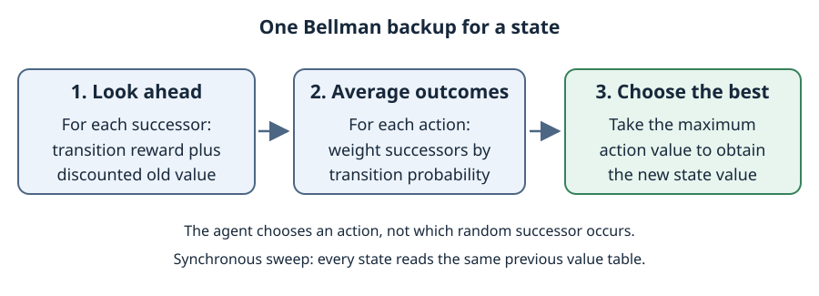

# Chapter 16 — Making Complex Decisions

**Course:** CAI 4002 — Introduction to Artificial Intelligence (USF Fall 2026)

**Sections:** 16.1 Sequential Decision Problems, introduction and §§16.1.1–16.1.2 (pp. 552–559) · 16.2.1 Value Iteration (pp. 562–566) · 16.2.2 Policy Iteration (pp. 566–568).

**Class notes:** *Day 9 — Probability Theory + Markov Decision Processes*, slides 44–90 · *Day 10 — MDP & Value Iteration*, slides 1–57. Reinforcement learning from the rest of Day 10 appears in [Chapter 23](chapter-23-reinforcement-learning.md).

## Section 16.1 — Sequential Decision Problems

### 1. Decisions with Uncertain Outcomes

An action can have several possible outcomes. The agent must choose actions that work well **in expectation**, not assume that every move succeeds.

> **Definition (Markov decision process).** An MDP models sequential decisions in a fully observable, stochastic environment using states, available actions, transition probabilities, and additive rewards.

| Component | Meaning |
|---|---|
| $S$ | set of states; $s_0$ is the start state |
| $A(s)$ | actions available in state $s$ |
| $T(s,a,s')$ | probability that action $a$ in $s$ leads to $s'$ |
| $R(s,a,s')$ | immediate reward for that transition |
| Terminal states | states where the episode ends, if any |
| $\gamma$ | discount factor specifying how future rewards are weighted |

The transition model is also called the **dynamics**:

$$
T(s,a,s')=P(S_{t+1}=s'\mid S_t=s,A_t=a),
\qquad \sum_{s'\in S}T(s,a,s')=1.
$$

A terminal state needs no further action. A continuing MDP need not have a terminal state.

### 2. What Makes a State Markov?

The current state must contain everything needed to predict the next outcome **given the chosen action**.

> **Definition (Markov property).** Conditional on the present state and action, the next-state distribution does not depend on the earlier history.

$$
P(S_{t+1}=s'\mid S_0,A_0,\ldots,S_t=s,A_t=a)
=P(S_{t+1}=s'\mid S_t=s,A_t=a).
$$

“Only the current state matters” does **not** mean that the action is irrelevant. If movement depends on fuel, position alone is not a sufficient state: include fuel. If a past event still affects outcomes, include the relevant information in the state rather than silently ignoring it.

### 3. Noisy Gridworld and Self-Loops

The lecture's gridworld has four movement actions. An intended move occurs with probability **0.8**; each perpendicular slip occurs with probability **0.1**. A wall or boundary blocks movement, leaving the agent in its current square.

> **Definition (Self-loop).** A transition whose successor is the same state as its source.

Different physical outcomes can produce the **same successor state**. Add their probabilities when building $T$; do not overwrite one with another. If the intended move and one slip are both blocked, their combined self-loop probability is $0.8+0.1=0.9$.

In the textbook's grid, the start is $(1,1)$, the interior wall is $(2,2)$, and the terminal rewards are $+1$ at $(4,3)$ and $-1$ at $(4,2)$.

The fixed sequence **Up, Up, Right, Right, Right** follows its intended route with probability:

$$
0.8^5=0.32768.
$$

This is the **no-slip trajectory probability**, not necessarily the total probability of success. Here another trajectory also reaches the goal, so the textbook's total is $0.32768+0.00008=0.32776$. The slide's shorter calculation leaves that alternative out.

### 4. Policy versus Fixed Plan

A fixed action sequence cannot adapt when a slip puts the agent somewhere unexpected. A policy selects the next action from the state actually reached.

> **Definition (Policy).** A stationary deterministic policy maps each nonterminal state to an available action: $\pi(s)\in A(s)$.

> **Definition (Optimal policy).** A policy maximizing expected cumulative utility, not the reward of every individual outcome.

Executing the same policy twice can produce different trajectories. Multiple policies can be optimal when actions tie.

For a finite horizon, the best action can depend on **time remaining**, so the policy may be nonstationary. For a finite, time-homogeneous discounted MDP, an optimal stationary deterministic policy exists; its recommendation does not need the starting state as an extra input.

### 5. Living Rewards, Risk, and Termination

Rewards define the tradeoff between reaching a desirable exit, avoiding danger, and spending more time in the environment.

In the lecture's **racing MDP**, the robot car can be Cool, Warm, or Overheated, and chooses Slow or Fast. Fast gives twice the immediate movement reward, but heating and the risk of overheating affect future returns. A larger immediate reward need not make an action optimal over the whole trip.

> **Definition (Living reward).** A reward received for continuing through ordinary nonterminal transitions.

- **Slightly negative:** a longer, safer route may beat a shorter route near the bad exit.
- **More negative:** avoiding extra steps becomes more important, so a riskier shortcut may be preferred.
- **Very negative:** even the bad exit may be preferable to a long delay.
- **Positive:** remaining alive can be attractive, potentially favoring a policy that avoids exits.

These are changes in optimal behavior under an **expected-return objective**, not proof that the agent has a separate risk-seeking or risk-averse utility function.

A positive living reward does **not always** make endless looping optimal. The answer depends on terminal rewards, discounting, and whether safe continued reward is possible. With no discount, a sustainable positive-reward loop can yield infinite return; with $\gamma<1$, its discounted return is finite and must still be compared with exiting.

### 6. Reward Timing and Discounted Return

Count each reward at the transition or state where the model says it occurs. Do not combine incompatible conventions.

> **Convention used here.** $R(s,a,s')$ is earned on the transition into $s'$. A terminal state's continuation value is zero because there are no rewards left after entry.

Thus, a transition into a terminal state receives its terminal reward **once**. Do not also assign that same reward as a future terminal value. The local textbook uses this transition-based convention too; its $U(s)$ corresponds to the lecture's optimal $V(s)$.

A model written with $R(s)$ or $R(s')$ must specify whether reward is attached to occupying or entering a state. Some lecture examples use an explicit **Exit** action from a reward square; that square is then not yet the final terminal state. Match reward timing and discount exponents to the chosen model.

> **Definition (Discounted return).** The utility of a trajectory is the sum of its rewards, with later rewards multiplied by increasing powers of $\gamma$.

$$
G_t=\sum_{j=0}^{\infty}\gamma^jR(S_{t+j},A_{t+j},S_{t+j+1}).
$$

The first transition reward is undiscounted; the next is multiplied by $\gamma$, then $\gamma^2$, and so on. For an episode, the sum stops after the final rewarded transition.

| Discount | Interpretation |
|---|---|
| $\gamma=0$ | only the immediate reward matters |
| $0<\gamma<1$ | later rewards matter less; larger $\gamma$ gives more weight to distant consequences |
| $\gamma=1$ | ordinary undiscounted sum; additional assumptions are needed for infinite-horizon problems |

With bounded rewards and $0\le\gamma<1$, even an infinite trajectory has bounded return:

$$
\vert R(s,a,s')\vert\le R_{\max}
\quad\Longrightarrow\quad
\vert G_t\vert\le\frac{R_{\max}}{1-\gamma}.
$$

A **proper policy** reaches a terminal state with probability one. Undiscounted analysis also needs suitable termination and finite-return conditions; the mere existence of a terminal state is not enough. Average reward per step is a different objective from discounted total reward.

Example — Rewards now or later?

*Original practice modeled on Day 9's reward-sequence discounting slides 58–60.*

A robot must choose between two plans with **guaranteed rewards**:

- **Quick:** receive 6 points, then 0, then 0.
- **Patient:** receive 0 points, then 0, then 20.

Each plan ends after three steps. The discount factor is $\gamma=0.5$: the first reward is undiscounted, the second is multiplied by $\gamma$, and the third by $\gamma^2$.

Which plan gives the greater discounted total reward? Show the total for each plan.

Solution

Apply the discount according to **when each reward arrives**, not according to how large it is. The full calculations are shown immediately below the example dropdown.

Omitting the discount factors on the zero rewards gives the same totals, because those terms remain zero. The 20-point reward is discounted **twice**, not once, because it arrives in the third position.

**Choose Quick: 6 versus 5.** Patient gives more undiscounted points, but the delayed reward is worth less under this discount factor.

**Discounted calculations for the example:**

$$
\begin{aligned}
G_{\text{Quick}} &= 6+0.5(0)+(0.5)^2(0)=6,\\
G_{\text{Patient}} &= 0+0.5(0)+(0.5)^2(20)=5.
\end{aligned}
$$

### 7. State Values, Q-Values, and the Bellman Equation

A value is an expected future return, not an immediate reward or a probability of success.

> **Definition (Policy value).** $V^\pi(s)$ is the expected return starting in $s$ and following policy $\pi$.

> **Definition (Optimal state value).** $V^{\ast}(s)$ is the greatest expected return achievable from $s$.

> **Definition (Optimal action value).** $Q^{\ast}(s,a)$ is the expected return from taking action $a$ first in $s$, then acting optimally afterward.

$$
V^\pi(s)=\mathbb{E}_\pi[G_0\mid S_0=s],
\qquad V^{\ast}(s)=\max_\pi V^\pi(s).
$$

A state node chooses an action; a **q-state** $(s,a)$ averages over that action's random outcomes. This is the max/chance structure of expectimax, compressed into reusable quantities.

$$
Q^{\ast}(s,a)=\sum_{s'\in S}T(s,a,s')\left[R(s,a,s')+\gamma V^{\ast}(s')\right].
$$

> **Bellman optimality equation.** The best value is the best action's expected immediate reward plus discounted optimal continuation value.

$$
V^{\ast}(s)=\max_{a\in A(s)}Q^{\ast}(s,a)
=\max_{a\in A(s)}\sum_{s'\in S}T(s,a,s')\left[R(s,a,s')+\gamma V^{\ast}(s')\right].
$$

Extract an optimal action using:

$$
\pi^{\ast}(s)\in\arg\max_{a\in A(s)}Q^{\ast}(s,a).
$$

**Max returns a value; argmax identifies an action.** Choose any maximizing action when there is a tie. With a value table alone, policy extraction requires a one-step backup using $T$ and $R$; a Q-table already scores the actions directly.

## Section 16.2.1 — Value Iteration

### 8. Time-Limited Values

An expectimax tree repeatedly recomputes the same states. Dynamic programming instead stores one value per state and reuses those results.

> **Definition (Time-limited value).** $V_k(s)$ is the optimal expected discounted return when exactly $k$ decision steps remain, with zero additional payoff at the horizon cutoff.

Start with $V_0(s)=0$: no steps remain, so no further transition rewards can be collected. Extend the horizon by one step:

$$
V_{k+1}(s)=\max_{a\in A(s)}\sum_{s'\in S}T(s,a,s')\left[R(s,a,s')+\gamma V_k(s')\right].
$$

Keep terminal values zero under the transition-reward convention. Each backup combines **one immediate reward** with the best value for the remaining $k$ steps. A finite-horizon action choice must use the corresponding remaining-horizon table.

### 9. Synchronous Value Iteration

> **Definition (Value iteration).** Repeatedly apply the Bellman backup to a table of state values until the estimates are sufficiently accurate.

1. Initialize the entire old-value table to zero.
2. Compute a new value for **every nonterminal state using only the old table**.
3. Finish the sweep, then replace the old table with the new table.
4. Repeat; extract actions by maximizing a one-step expected return.

Do not use a newly updated neighbor halfway through a synchronous sweep. In-place updates are a different update schedule, so they do not have the same exact $k$-step interpretation.

With zero initialization, successive sweeps reproduce the time-limited values above. Immediate-reward information spreads through predecessor states as the number of backups increases.

### 10. Convergence and Stopping

> **Convergence guarantee.** For a finite MDP with bounded rewards and $0\le\gamma<1$, value iteration converges to the unique optimal value function. The optimal policy need not be unique.

The Bellman backup operator $B$ shrinks the largest difference between two value tables:

$$
\lVert BV-BW\rVert_\infty\le\gamma\lVert V-W\rVert_\infty,
\qquad \lVert V\rVert_\infty=\max_{s\in S}\vert V(s)\vert.
$$

This **contraction** explains why repeated backups approach the same fixed point. Values closer together after a sweep are not merely an accidental feature of the gridworld.

For $0<\gamma<1$, measure the largest change in a completed synchronous sweep:

$$
\delta_k=\max_{s\in S}\vert V_{k+1}(s)-V_k(s)\vert.
$$

A sufficient condition for the **new** table to have maximum value error at most $\epsilon$ is:

$$
\delta_k\le\epsilon\frac{1-\gamma}{\gamma}
\quad\Longrightarrow\quad
\lVert V_{k+1}-V^{\ast}\rVert_\infty\le\epsilon.
$$

At $\gamma=0$, one backup already gives the optimal immediate-reward values; do not use a stopping formula that divides by zero. At $\gamma=1$, the contraction guarantee above does not apply: suitable episodic/proper-policy assumptions are required. Larger discounts closer to one generally weaken the contraction and can require more sweeps.

### 11. Cost and What Has Actually Converged

A dense backup considers every state, every action, and every possible successor. One complete iteration costs $O(\vert S\vert^2\vert A\vert)$; this is **per sweep**, not the total cost of solving the MDP.

If each state–action pair has at most $d$ nonzero-probability successors, sparse backups cost $O(\vert S\vert\vert A\vert d)$ per sweep. With bounded $d$, this becomes $O(\vert S\vert\vert A\vert)$. Two value tables use $O(\vert S\vert)$ working storage, apart from the stored model.

A **policy can become optimal before its numerical values converge**: the best action may already be clear even while estimates keep changing. However, observing the same policy for a few sweeps is not by itself a general certificate of optimality.

- **Values:** one expected return per state; describe how good states are.
- **Q-values:** one expected return per state–action pair; compare choices directly.
- **Policy:** an action recommendation per state; describes behavior, not its numerical quality.

## Section 16.2.2 — Policy Iteration

### 12. Day 10 — Evaluate, Then Improve

Value iteration chooses a best action in every backup. Policy iteration instead alternates between evaluating one fixed policy and improving that policy.

> **Definition (Policy evaluation).** Find the expected return from each state when the agent follows a specified policy, not necessarily an optimal one.

For a fixed deterministic policy, the Bellman equation contains **no maximum over actions**:

$$
V^\pi(s)=\sum_{s'\in S}T(s,\pi(s),s')\left[R(s,\pi(s),s')+\gamma V^\pi(s')\right].
$$

The action is fixed by $\pi(s)$, but its possible outcomes are still averaged. Evaluation can solve these simultaneous equations directly or repeatedly update values for the fixed policy.

> **Definition (Policy improvement).** Choose an action with the greatest one-step expected return, using the evaluated policy's values for the continuation.

$$
\pi_{\text{new}}(s)\in\arg\max_{a\in A(s)}\sum_{s'\in S}T(s,a,s')\left[R(s,a,s')+\gamma V^\pi(s')\right].
$$

Start with a policy, evaluate it, improve it, and repeat. With exact evaluation in a finite discounted MDP, a policy that cannot be strictly improved is optimal. Keeping the current action when it ties for best prevents unnecessary switching between equally good policies. Approximate or partial evaluation can be useful, but an unchanged approximate policy alone is not the same certificate.

### 13. Comparing the Algorithms

| | Value iteration | Policy iteration |
|---|---|---|
| Main operation | maximize in every state-value backup | evaluate a fixed policy, then improve it |
| Evaluation backup | considers every action | considers the policy's one action per state |
| Dense sweep | $O(\vert S\vert^2\vert A\vert)$ | $O(\vert S\vert^2)$ for one evaluation sweep |
| Extra work | repeat value sweeps | repeat evaluation sweeps or solve equations, then improve the policy |

These are **per-sweep** costs, not total algorithm costs. Policy improvement still examines actions; with at most $d$ successors per state–action pair, an evaluation sweep costs $O(\vert S\vert d)$. Which method is faster depends on the model and how evaluation is performed. Doing only some evaluation updates before improvement is called **modified policy iteration**.

## Quick Reference

| Term | Meaning |
|---|---|
| MDP | states, available actions, stochastic dynamics, rewards, start state, and a return objective |
| Markov property | next outcome depends on the present state and chosen action, not earlier history |
| $T(s,a,s')$ | probability of successor $s'$ after action $a$ in state $s$ |
| Self-loop | no state change; combine probabilities of outcomes leading to the same state |
| $R(s,a,s')$ | immediate transition reward; count terminal payoff once |
| $\gamma$ | discount factor; $0\le\gamma<1$ gives the standard discounted guarantee |
| $V^{\ast}(s)$ | optimal expected return starting in state $s$ |
| $Q^{\ast}(s,a)$ | take $a$ first, then act optimally |
| $\pi^{\ast}(s)$ | any action maximizing the optimal Q-value |
| $V_k(s)$ | optimal return with $k$ steps remaining; $V_0(s)=0$ |
| Bellman backup | maximize over actions; average over stochastic successors |
| Synchronous update | all new values use the previous sweep's table |
| Dense sweep cost | $O(\vert S\vert^2\vert A\vert)$ |
| Sparse sweep cost | $O(\vert S\vert\vert A\vert d)$ for at most $d$ successors per state–action pair |
| Convergence | unique optimal values for finite discounted MDPs with bounded rewards; possibly several optimal policies |
| Policy evaluation | calculate values for a fixed policy; average successor outcomes without maximizing |
| Policy improvement | choose actions by one-step look-ahead using the current policy's values |
| Policy iteration | alternate evaluation and improvement until no strict improvement remains |
